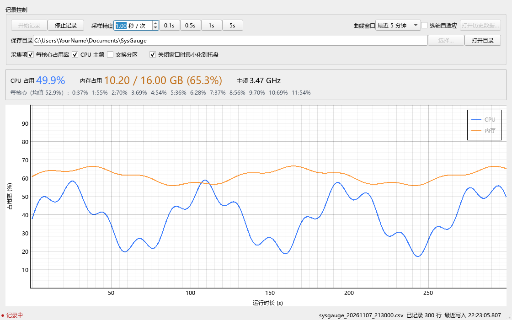
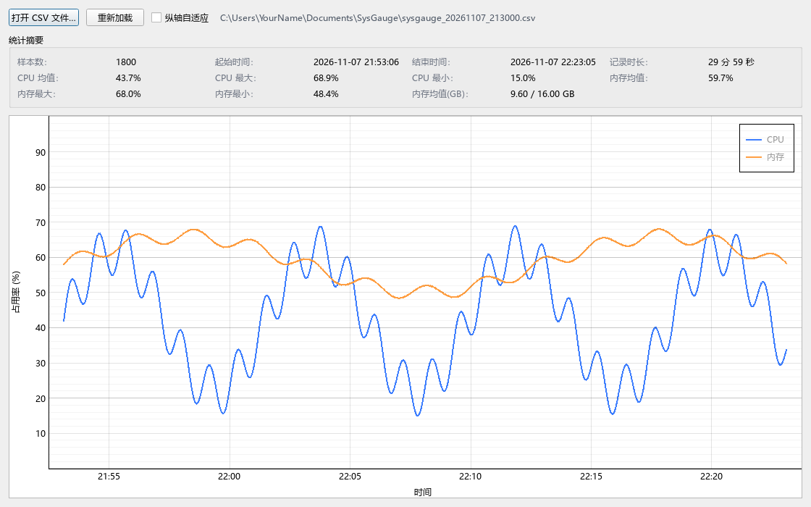

# SysGauge

**English** · [简体中文](README.zh-CN.md)

> A lightweight, reliable Windows CPU / memory usage recorder: real-time charts plus line-by-line CSV logging.


SysGauge samples system metrics with `psutil`, draws real-time charts with PySide6 + pyqtgraph, and runs `flush + fsync` after every sample when writing CSV. It is built for long recording sessions, stutter investigations, and performance test reports.

## Screenshots





## Features

- **Real-time charts**: CPU and memory curves with 1-minute / 5-minute / 15-minute / 1-hour display windows.
- **Precise sampling**: Interval adjustable from 0.1 s to 60 s, with 0.1 / 0.5 / 1 / 5 s presets; absolute-time scheduling avoids drift during long runs.
- **Power-loss safe**: Append-only writes, `flush + fsync` after every line; a crash or power loss can damage at most the last line, keeping earlier data intact.
- **Optional metrics**: Per-core usage, CPU frequency, and swap; when disabled, the corresponding CSV columns stay empty.
- **Automatic rotation**: Once a file reaches the threshold (100 MB by default), a new `_partN` file is created; rotation can be disabled.
- **History viewer**: Load a CSV to plot curves and show sample count, time range, and CPU / memory mean, min, and max; truncated lines from power loss are skipped automatically.
- **Chart interaction**: Y axis locked to 0–100; pan and zoom horizontally by default. With "Adaptive Y axis" enabled, the axis fits the visible data range, marks extremes with dashed lines, and can be zoomed with Ctrl + wheel.
- **Hover readout**: Both live and history charts show a vertical guide line and the CPU / memory values at that moment.
- **Tray resident**: Closing the window minimizes to the tray and recording continues; the tray icon color follows CPU usage.
- **Single instance**: Launching again activates the existing window, preventing multiple instances from writing at once.
- **Light/dark adaptive**: Chart colors come from the system palette and follow the window theme.

## Requirements

- Windows 10 / 11 (x64)
- Python 3.10 or newer (tested on 3.12.3)
- Dependencies: see [requirements.txt](requirements.txt)

## Quick Start

```powershell
git clone https://github.com/qepan0520/SysGauge.git
cd SysGauge

python -m venv .venv
.\.venv\Scripts\Activate.ps1
pip install -r requirements.txt

python run.py
```

> Using the project-local `.venv` is recommended. `requirements.txt` pins `PySide6==6.6.3.1` to avoid the `DLL load failed` error on startup that affects 6.12 in some environments.

## Usage

1. Click **Start recording**; the app creates `sysgauge_YYYYMMDD_HHMMSS.csv` in the save directory and starts writing.
2. Adjust the interval with **Sampling interval**; changes take effect immediately while running.
3. Choose metrics under **Metrics**; unselected metrics are not sampled and their CSV columns are written empty, keeping the schema unchanged.
4. Click **Stop recording** to end the session and make sure data is flushed.
5. Closing the window **minimizes to tray** by default and recording continues; choose **Quit** in the tray menu to actually exit the process.
6. Click **Open history…** to select an existing CSV and inspect curves and summary statistics.

### Chart mouse controls

| Action | Effect |
| --- | --- |
| Wheel | Zoom the time axis |
| Left / middle drag | Pan horizontally |
| Hover | Show a guide line and values at that moment |
| Ctrl + wheel (with "Adaptive Y axis") | Zoom the Y axis |
| Right drag (with "Adaptive Y axis") | Adjust the Y-axis range |

## Data files

### Locations

| Item | Default path |
| --- | --- |
| CSV data | `%USERPROFILE%\Documents\SysGauge\` (changeable in the UI) |
| App config | `%APPDATA%\SysGauge\config.json` |
| Runtime log | `%APPDATA%\SysGauge\logs\sysgauge.log` |

### Naming and rotation

- Each **Start recording** creates a new file: `sysgauge_YYYYMMDD_HHMMSS.csv`
- After the rotation threshold: `sysgauge_YYYYMMDD_HHMMSS_part2.csv`, `_part3.csv`, …
- At a 1 s interval a row is roughly 0.1 KB; 100 MB holds about 11 days of data. Adjust or disable rotation in the config.

### CSV columns

| Column | Type | Description |
| --- | --- | --- |
| `timestamp_iso` | ISO 8601 | Local time with millisecond precision |
| `timestamp_unix_ms` | int | Unix timestamp in milliseconds, handy for sorting and math |
| `cpu_percent` | float | Overall CPU usage (0–100) |
| `cpu_percent_cores` | string | Per-core usage separated by `\|`; empty when disabled |
| `cpu_freq_mhz` | float | Current CPU frequency (MHz); empty when unavailable |
| `mem_percent` | float | Physical memory usage (0–100) |
| `mem_used_bytes` | int | Used physical memory in bytes |
| `mem_available_bytes` | int | Available physical memory in bytes |
| `mem_total_bytes` | int | Total physical memory in bytes |
| `swap_percent` | float | Swap usage; empty when disabled |
| `swap_used_bytes` | int | Used swap in bytes; empty when disabled |
| `swap_total_bytes` | int | Total swap in bytes; empty when disabled |

Memory is stored in bytes to avoid rounding errors; divide by `1024^3` in Excel to get GB.

## Build an EXE

The project ships a PyInstaller config and a one-click script:

```bat
build.bat
```

Produces `dist\SysGauge.exe` (single file, no console window).

To keep a versioned copy:

```bat
build.bat V02
```

Besides `dist\SysGauge.exe`, a copy is written to `dist\versions\SysGauge_V02.exe` so earlier versions are preserved.

> When publishing a GitHub Release, upload `dist\SysGauge.exe` as a release asset. `build/`, `dist/`, and virtual environments are already in `.gitignore` and should not be committed.

## Project structure

```text
SysGauge/
├── app/
│   ├── main.py           # Entry point: logging, crash fallback, single instance, tray
│   ├── main_window.py    # Main window and recording control
│   ├── chart.py          # Live / history chart widgets
│   ├── history.py        # CSV parsing and history window
│   ├── metrics.py        # psutil metric collection and CSV column definitions
│   ├── sampler.py        # Sampling thread (absolute-time scheduling)
│   ├── recorder.py       # CSV append, fsync, file rotation
│   └── config.py         # Config read/write and validation
├── assets/               # App icons (ICO / SVG)
├── docs/screenshots/     # README screenshots
├── run.py                # Development entry point
├── build.bat             # One-click build script
├── sysgauge.spec         # PyInstaller config
├── requirements.txt      # Runtime and build dependencies
└── LICENSE
```

## FAQ

**`ImportError: DLL load failed` at startup?**

Make sure you use Python 3.10+ with `PySide6==6.6.3.1` pinned in `requirements.txt`, and use the project-local `.venv` instead of mixing in global environments such as Anaconda base.

**Does high-frequency sampling hurt performance?**

Every row is `fsync`ed; below 0.5 s the disk I/O overhead grows noticeably, and the UI warns you about it.

**The app keeps running after I close the window?**

That is the default tray behavior and recording continues. Choose **Quit** in the tray menu, or uncheck "Minimize to tray when closing".

**The last line of a history file is incomplete?**

A power loss or a forced kill can damage the last line only. The history window skips malformed rows automatically and reports how many were skipped.

**Why can't the data directory be opened or written?**

The app checks directory writability; if it is not writable, it falls back to `%USERPROFILE%\Documents\SysGauge` and shows a notice.

## Privacy

All data stays on your machine. The app does not access the network or upload anything.

## License

Released under the [MIT License](LICENSE).
