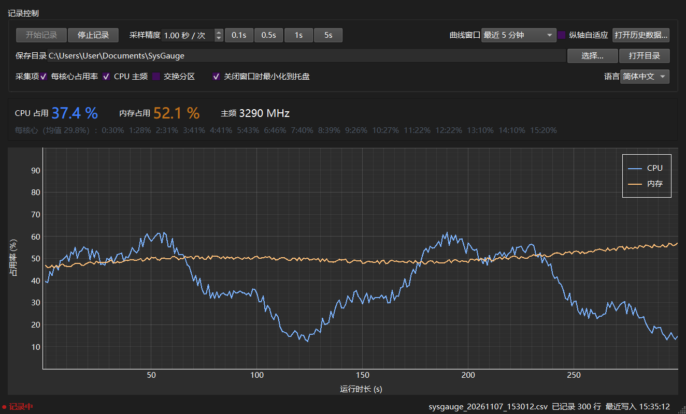
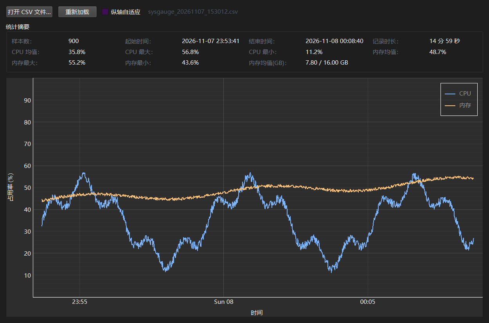

# SysGauge

[English](README.md) · **简体中文**

> 轻量、可靠的 Windows CPU / 内存占用记录工具：实时曲线 + 逐行落盘的 CSV。


SysGauge 基于 `psutil` 采集系统指标，使用 PySide6 + pyqtgraph 绘制实时曲线，并在每次采样后立即 `flush + fsync` 写入 CSV。适合长时间记录 CPU / 内存占用、排查卡顿、制作性能测试报告。

## 界面预览





## 功能特性

- **实时曲线**：CPU 与内存双曲线，支持最近 1 分钟 / 5 分钟 / 15 分钟 / 1 小时显示窗口。
- **精确采样**：采样间隔 0.1 s ~ 60 s 可调，提供 0.1 / 0.5 / 1 / 5 s 快捷预设；采用绝对时间点调度，长时间运行不累积漂移。
- **断电安全**：只追加不修改，每写一行立即 `flush + fsync`；崩溃或断电最多损坏最后一行，历史数据保持完好。
- **可选采集项**：每核心占用率、CPU 主频、交换分区，按需开启，不开启时 CSV 对应列留空。
- **自动切分**：单个文件达到阈值（默认 100 MB）后自动新建 `_partN` 文件，可设为不切分。
- **历史回看**：载入 CSV 绘制曲线，并给出样本数、时间范围、CPU / 内存均值与最大最小值；自动跳过断电导致的残缺行。
- **图表交互**：纵轴锁定 0 ~ 100；默认仅横向平移 / 缩放。开启「纵轴自适应」后纵轴贴合可见数据的谷值与峰值并画虚线标记，可用 Ctrl + 滚轮缩放纵轴。
- **悬停读数**：实时与历史图表均支持鼠标悬停，显示虚线竖线与该时刻的 CPU / 内存数值。
- **托盘常驻**：关闭窗口默认最小化到托盘继续记录；托盘图标颜色随 CPU 占用率变化。
- **单实例运行**：重复启动会激活已有窗口，避免多个实例同时写数据。
- **明暗主题自适应**：图表配色取自系统调色板，跟随窗口主题变化。
- **多语言界面**：支持英文、简体中文、日本語、Deutsch、Español，主窗口内即可切换；选择会被记住，首次启动跟随系统语言。

## 环境要求

- Windows 10 / 11（x64）
- Python 3.10 及以上（已在 3.12.3 测试）
- 依赖见 [requirements.txt](requirements.txt)

## 快速开始

```powershell
git clone https://github.com/qepan0520/SysGauge.git
cd SysGauge

python -m venv .venv
.\.venv\Scripts\Activate.ps1
pip install -r requirements.txt

python run.py
```

> 建议使用项目内的 `.venv` 虚拟环境。`requirements.txt` 已锁定 `PySide6==6.6.3.1`，用于规避部分环境下 6.12 版本启动时报 `DLL load failed` 的问题。

## 使用说明

1. 点击 **开始记录**，程序会在保存目录新建 `sysgauge_YYYYMMDD_HHMMSS.csv` 并开始写入。
2. 通过 **采样精度** 调整记录间隔；运行中修改立即生效。
3. 通过 **采集项** 勾选需要的指标；未勾选的指标不采集，CSV 对应列写入空值，表结构保持不变。
4. 点击 **停止记录** 结束本次会话并确保数据刷盘。
5. 关闭窗口默认**最小化到托盘**，记录继续进行；在托盘菜单中选择「退出」才会真正结束进程。
6. 点击 **打开历史数据…** 选择已有 CSV，查看曲线与统计摘要。

### 图表鼠标操作

| 操作 | 效果 |
| --- | --- |
| 滚轮 | 横向缩放时间轴 |
| 左键 / 中键拖拽 | 横向平移 |
| 鼠标悬停 | 显示竖线与该时刻读数 |
| 勾选「纵轴自适应」后 Ctrl + 滚轮 | 缩放纵轴 |
| 勾选「纵轴自适应」后右键拖拽 | 调整纵轴范围 |

## 数据文件

### 保存位置

| 内容 | 默认路径 |
| --- | --- |
| CSV 数据 | `%USERPROFILE%\Documents\SysGauge\`（可在界面中修改） |
| 应用配置 | `%APPDATA%\SysGauge\config.json` |
| 运行日志 | `%APPDATA%\SysGauge\logs\sysgauge.log` |

### 文件命名与切分

- 每次「开始记录」新建一个文件：`sysgauge_YYYYMMDD_HHMMSS.csv`
- 达到切分阈值后：`sysgauge_YYYYMMDD_HHMMSS_part2.csv`、`_part3.csv` ……
- 采样间隔 1 s 时约 0.1 KB/行，100 MB 约可记录 11 天；可在配置中调整或关闭切分。

### CSV 列说明

| 列名 | 类型 | 说明 |
| --- | --- | --- |
| `timestamp_iso` | ISO 8601 | 本地时间，毫秒精度 |
| `timestamp_unix_ms` | int | Unix 毫秒时间戳，便于排序与计算 |
| `cpu_percent` | float | 整机 CPU 占用率（0 ~ 100） |
| `cpu_percent_cores` | string | 每核心占用率，以 `\|` 分隔；未开启时为空 |
| `cpu_freq_mhz` | float | 当前 CPU 主频（MHz）；不可用时为空 |
| `mem_percent` | float | 物理内存占用率（0 ~ 100） |
| `mem_used_bytes` | int | 已用物理内存（字节） |
| `mem_available_bytes` | int | 可用物理内存（字节） |
| `mem_total_bytes` | int | 物理内存总量（字节） |
| `swap_percent` | float | 交换分区占用率；未开启时为空 |
| `swap_used_bytes` | int | 已用交换分区（字节）；未开启时为空 |
| `swap_total_bytes` | int | 交换分区总量（字节）；未开启时为空 |

内存统一以字节存储，避免舍入误差；在 Excel 中除以 `1024^3` 即可换算为 GB。

## 打包为 EXE

项目已提供 PyInstaller 配置与一键脚本：

```bat
build.bat
```

生成 `dist\SysGauge.exe`（单文件、无控制台窗口）。

如需归档指定版本：

```bat
build.bat V02
```

除生成 `dist\SysGauge.exe` 外，还会复制一份到 `dist\versions\SysGauge_V02.exe`，历史版本不会被覆盖。

> 发布 GitHub Release 时，可将 `dist\SysGauge.exe` 作为 Release 附件上传；`build/`、`dist/` 与虚拟环境已加入 `.gitignore`，无需提交进仓库。

## 项目结构

```text
SysGauge/
├── app/
│   ├── main.py           # 程序入口：日志、异常兜底、单实例、托盘
│   ├── main_window.py    # 主窗口与记录控制
│   ├── chart.py          # 实时 / 历史曲线控件
│   ├── history.py        # CSV 解析与历史数据窗口
│   ├── metrics.py        # psutil 指标采集与 CSV 列定义
│   ├── sampler.py        # 采样线程（绝对时间调度）
│   ├── recorder.py       # CSV 追加写入、fsync、文件切分
│   ├── i18n.py           # 界面文案与语言切换
│   └── config.py         # 配置读写与校验
├── assets/               # 应用图标（ICO / SVG）
├── docs/screenshots/     # README 截图
├── run.py                # 开发期入口
├── build.bat             # 一键打包脚本
├── sysgauge.spec         # PyInstaller 打包配置
├── requirements.txt      # 运行与打包依赖
└── LICENSE
```

## 常见问题

**启动时报 `ImportError: DLL load failed`？**

请确认使用 Python 3.10+ 与 `requirements.txt` 中锁定的 `PySide6==6.6.3.1`，并使用项目内 `.venv`，避免混用 Anaconda base 等全局环境。

**高频采样会影响性能吗？**

每行数据都会执行 `fsync`，采样间隔低于 0.5 s 时磁盘 I/O 会明显增加，界面会给出提示。

**关闭窗口后程序还在运行？**

这是默认的托盘驻留行为，记录不会中断。可在托盘菜单中选择「退出」，或取消勾选「关闭窗口时最小化到托盘」。

**历史文件最后一行不完整？**

断电或强制结束进程时可能只损坏最后一行。历史数据窗口会自动跳过异常行，并在界面上提示跳过数量。

**为什么数据目录打不开 / 无法写入？**

程序会检查目录可写性；不可写时会回落到默认目录 `%USERPROFILE%\Documents\SysGauge`，并给出提示。

## 隐私

所有数据仅保存在本机。程序不联网，不上传任何信息。

## 许可证

本项目基于 [MIT License](LICENSE) 开源。
